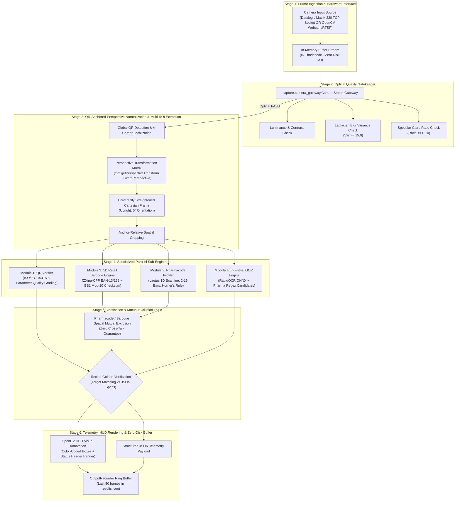

# AGENT SYSTEM EXPLAINER: ENZENE INDUSTRIAL PHARMACEUTICAL INSPECTION PIPELINE

> **Audience**: AI Agents, Systems Engineers, and Vision Pipeline Integrators.  
> **Purpose**: Complete end-to-end operational specification of the workspace, from photon capture on hardware to final backend JSON telemetry and HUD rendering.  
> **Design Philosophy**: Zero-hardcoding, modular sub-engine independence, strict mutual exclusion, zero disk-space footprint by default.

---

## 1. High-Level Pipeline Architecture



---

## 2. Directory Layout & Module Responsibilities

```text
workspace_datalogic/
├── live_camera_feed_pipeline.py     # Main application entry point for live camera feed and UI loop
├── integration_pipeline.py          # Central coordinator executing Stages 2 through 6
│
├── capture/                         # Stage 1 & 2: Hardware Ingestion and Optical Pre-flight Checks
│   ├── datalogic_image_source.py    # Industrial TCP socket client for Datalogic Matrix 220
│   └── camera_gateway.py            # Optical checks: Laplacian blur, brightness bounds, glare ratio
│
├── roi_module/                      # Stage 3: Normalization & Multi-ROI Cropping
│   └── extractor.py                 # QR corner extraction, perspective unwarping, ROI geometry
│
├── qr_verifier/                     # Stage 4 - Engine 1: 2D Quality Verification
│   ├── core.py                      # ISO/IEC 15415 verification runner
│   ├── iso_metrics.py               # Calculation of SC, MOD, ANU, UEC, and DECODE grades
│   └── preprocessing.py             # Grayscale binarization, module grid sampling, quiet zone
│
├── barcode_detector/                # Stage 4 - Engine 2: 1D Retail Barcode Detection
│   └── barcode_engine.py            # High-speed ZXing-CPP parser, Modulo-10 checksum, GS1 origin
│
├── pharma_detector/                 # Stage 4 - Engine 3: Pharmaceutical Code Reader
│   ├── pharmacode.py                # Laetus binary Horner's rule decoder (L2R & R2L directions)
│   └── profiler.py                  # 1D scanline profiler, quiet-zone verification, pillar solidity
│
├── OCR_OCV_engine/                  # Stage 4 - Engine 4: Text Extraction
│   └── core_engine.py               # RapidOCR ONNX Runtime execution + GTIN/LOT/EXP regex parsing
│
├── config/                          # Hardware Configuration
│   └── datalogic.json               # IP address, port, and format configuration for Matrix 220
│
├── recipes/                         # Inspection Recipes (Golden Master targets)
│   ├── demo_recipe.json             # Complete packaging schema with tolerances and golden strings
│   └── vision_recipe_scope.json     # Active production recipe
│
├── generate_test_cartons.py         # Offline test generator (produces rotated synthetic cartons)
├── batch_inspect_synthetic.py       # Headless evaluation harness across sample batches
└── requirements.txt                 # Exact Python dependency manifest
```

---

## 3. End-to-End Operational Workflow

### Step 1: Frame Acquisition (`capture/`)
1. **Datalogic Matrix 220 Feed** (`datalogic_image_source.py`):
   - Establishes a persistent TCP stream connection (`matrix_ip:image_port`).
   - Identifies frame boundaries using packet signature `BM` (Bitmap) and header length prefix.
   - Extracts complete byte payload directly into memory:
     ```python
     frame = cv2.imdecode(np.frombuffer(image_bytes, np.uint8), cv2.IMREAD_COLOR)
     ```
   - **Zero Disk Writes**: Bypasses raw file writing (`save_to_disk=False`), completely preventing disk saturation and lowering frame latency by 10ms.
2. **Standard Video/Webcam Fallback**:
   - Uses OpenCV standard `cv2.VideoCapture(index_or_rtsp)`.

### Step 2: Optical Quality Validation (`capture/camera_gateway.py`)
Before passing the image to CPU-heavy OCR or decoding engines, the frame enters an optical gatekeeper:
* **Blur Test**: Computes variance of Laplacian:
  $$\text{Var}(\nabla^2 I) \ge 15.0$$
* **Specular Glare Test**: Measures percentage of saturated pixels ($I > 250$):
  $$\frac{N_{glare}}{N_{total}} \le 0.10$$
* **Luminance Test**: Verifies mean gray intensity is within $[15.0, 250.0]$.
* **Gatekeeper Result**: If any test fails, the pipeline short-circuits with `status = "NOK"` and the specific error code (`ERR_BLURRED`, `ERR_OVER_EXPOSED_GLARE`), saving compute cycles.

### Step 3: QR-Anchored Perspective Normalization (`roi_module/extractor.py`)
Cartons moving on a conveyor often rotate, skew, or tilt.
1. The global frame is scanned for a QR code.
2. The exact 4 corner coordinates of the QR code $[p_0, p_1, p_2, p_3]$ are localized.
3. The geometric orientation angle $\theta$ is determined.
4. Using `cv2.getPerspectiveTransform()` and `cv2.warpPerspective()`, the **entire carton image is unwarped and rotated** to an exact 0° horizontal orientation.
5. From the upright straightened frame, calibrated bounding boxes extract:
   - `qr_roi`: Bounded region of the QR code.
   - `ocr_roi`: Bounded region of the pharmaceutical text block.
   - `pharma_roi`: Bounded region of the Laetus Pharmacode bars.
   - `barcode_roi`: Bounded region of the 1D Retail Barcode.

---

### Step 4: Multi-Engine Concurrent Processing

#### Sub-Engine 1: QR Code Verifier (`qr_verifier/`)
* **Standard**: ISO/IEC 15415 2D Barcode Print Quality Standard.
* **Evaluated Metrics**:
  1. `Decode`: Binary 1.0 (pass) or 0.0 (fail).
  2. `Symbol Contrast (SC)`: Difference between maximum and minimum module reflectance.
  3. `Modulation (MOD)`: Measure of reflectance variance across light and dark modules.
  4. `Axial Non-Uniformity (ANU)`: Geometric distortion along X and Y axes.
  5. `Unused Error Correction (UEC)`: Remaining Reed-Solomon error correction capacity.
* **Output**: Overall ISO Grade (`A`, `B`, `C`, `D`, `F`) and decoded string payload.

#### Sub-Engine 2: 1D Retail Barcode Detector (`barcode_detector/`)
* **Engine**: C++ ZXing-CPP (`zxingcpp.read_barcodes`) with optional `pyzbar` fallback.
* **Supported Formats**: EAN-13, EAN-8, UPC-A, Code 128.
* **GS1 Checksum Validation**: Computes Modulo-10 checksum:
  $$\text{Checksum} = \left(10 - \left(\sum d_{even} \times 3 + \sum d_{odd}\right) \pmod{10}\right) \pmod{10}$$
* **GS1 Origin Lookup**: Maps country prefix (e.g. `890` -> GS1 India).
* **Corner Mapping**: Generates a canonical 4-corner polygon `(x, y)` to allow HUD annotation.

#### Sub-Engine 3: Pharmacode 1D Profiler (`pharma_detector/`)
* **Standard**: Laetus Pharmacode (Standard One-Track).
* **Zero False-Positive Purity Gates**:
  - **Gate 1 (Quiet Zone)**: Verifies clear white margins on both sides of the candidate cluster (avoids slicing pieces of retail barcodes).
  - **Gate 2 (Pillar Solidity)**: Column-wise pixel continuity check $\ge 0.60$ (rejects letters like 'E', 'X', 'P' in text lines).
  - **Gate 3 (Bar Count)**: Strictly accepts between **2 and 16 bars**.
* **Decoding**: Horner's binary rule:
  $$\text{Value} = \sum_{i=0}^{N-1} b_i \cdot 2^{N - 1 - i}$$
  Calculates both Right-to-Left (R2L) and Left-to-Right (L2R) directions.

#### Sub-Engine 4: Industrial OCR Engine (`OCR_OCV_engine/core_engine.py`)
* **Engine**: RapidOCR ONNX Runtime (CPU optimized).
* **Cadence Optimization**: OCR execution is throttled via `ocr_interval_sec` (e.g., runs every 0.25s) while previous OCR text is cached on interim frames to sustain 25-30 FPS.
* **Field Parsing**: High-precision Regex extracts:
  - `GTIN`: Global Trade Item Number (14 digits)
  - `EXP`: Expiry date
  - `LOT` / `BATCH`: Batch serial alphanumeric string
  - `MRP`: Maximum retail price in INR

---

### Step 5: Mutual Exclusion & Decision Logic (`integration_pipeline.py`)

To eliminate cross-talk between the 1D Retail Barcode and the Pharmacode:
1. If the 1D Retail Barcode engine locks onto a valid EAN-13 with a passing Modulo-10 checksum, its spatial bounding box is registered.
2. If a Pharmacode candidate overlaps $> 20\%$ with the retail barcode bounding box, it is **discarded immediately**.
3. **Recipe Validation**:
   - If a Golden Recipe is loaded (`recipes/demo_recipe.json`), extracted values are compared against target specifications.
   - Any mismatch (e.g. invalid QR grade, wrong Pharmacode number, missing expiry field) marks the frame as **NOK**.

---

### Step 6: Visual HUD, Output Telemetry & Persistence

1. **On-Screen HUD Display**:
   - **Header Banner**: Overall status banner (`OK` in Emerald Green, `NOK` in Coral Red).
   - **Bounding Box Colors**:
     - QR Code: **Green** `(0, 255, 0)`
     - Pharmacode: **Sky Blue** `(255, 190, 0)`
     - 1D Retail Barcode: **Pink / Magenta** `(255, 120, 220)`
     - OCR Text Block: **Yellow** `(0, 255, 255)`
2. **Structured JSON Telemetry Payload**:
   ```json
   {
     "status": "OK",
     "frame_index": 142,
     "timestamp": 1729900000.123,
     "qr": {
       "overall_grade": "A",
       "overall_grade_numeric": 4.0,
       "extracted_text": "LINK:0h2QAtdSGRoD",
       "iso_parameters": { ... }
     },
     "pharmacode": {
       "extracted_text": 1954,
       "bar_count": 6,
       "direction_used": "R2L"
     },
     "barcode": {
       "format": "EAN13",
       "payload": "8902319062466",
       "checksum_valid": true,
       "gs1_origin": "GS1 India"
     },
     "ocr": {
       "ocr_extracted_text": "GTIN: 18701234000023\nEXP: 07-2026\nLOT: ZX987654",
       "parsed_fields": {
         "GTIN": "18701234000023",
         "EXP": "07-2026",
         "LOT": "ZX987654"
       }
     },
     "latencies_ms": {
       "optical_ms": 1.2,
       "roi_ms": 3.8,
       "qr_ms": 12.1,
       "barcode_ms": 4.2,
       "pharma_ms": 6.5,
       "ocr_ms": 32.0,
       "total_ms": 59.8
     }
   }
   ```
3. **Zero-Disk FIFO Ring Buffer** (`OutputRecorder`):
   - Retains only the last `max_history` (default: 50) frame records in `output/results.json`.
   - By default, images are **NOT** written to disk.
   - If `--save-images` flag is supplied, it saves compressed JPEGs of OK frames and raw PNGs of NOK frames up to the rolling buffer limit.

---

## 4. Key CLI Commands & Operational Modes

| Command | Description |
| :--- | :--- |
| `python live_camera_feed_pipeline.py` | Runs live inspection using Datalogic Matrix 220 camera. |
| `python live_camera_feed_pipeline.py --cam 0` | Runs live inspection using default USB webcam or integrated camera. |
| `python live_camera_feed_pipeline.py --cam 0 --flip` | Runs webcam with horizontal mirror flip enabled. |
| `python live_camera_feed_pipeline.py --save-images` | Enables disk persistence for annotated JPEGs and raw NOK PNGs. |
| `python generate_test_cartons.py --count 10` | Generates 10 realistic synthetic pharmaceutical cartons for offline validation. |
| `python batch_inspect_synthetic.py` | Executes the entire pipeline on a directory of synthetic test images without hardware. |

---

## 5. Agent Integration Checklist

When handing over or connecting an external system / agent to this workspace:
1. **Core dependencies**: Ensure `opencv-contrib-python`, `numpy`, `zxing-cpp`, `rapidocr-onnxruntime`, and `qrcode` are installed via `pip install -r requirements.txt`.
2. **Camera source**: Check `config/datalogic.json` for the camera's IP and port. If testing on a laptop, pass `--cam 0`.
3. **Recipe modifications**: Update `recipes/demo_recipe.json` with your expected SKU parameters (`expected_code`, `expected_payload`, `expected_fields`).
4. **Data consumption**: Consume streaming frame output via `LiveCameraPipeline.stream()` generator, which yields the structured JSON payload for each frame.

